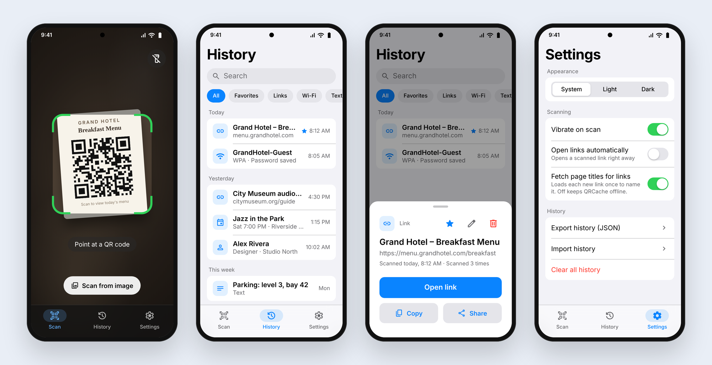

<div align="center">


# QRCache

**Scan once. Find it again.**

A free, open-source QR scanner for Android that remembers every code you scan,<br>
so you can reopen it later without hunting for the code again.

[](https://github.com/Eros-Byrne/QRCache/releases/latest)
[](https://github.com/Eros-Byrne/QRCache/actions/workflows/android.yml)
[](LICENSE)
[](#install)
[](https://kotlinlang.org)
[](https://developer.android.com/compose)

[**Download the APK**](https://github.com/Eros-Byrne/QRCache/releases/latest) · [Install guide](#install) · [Build from source](#build-from-source) · [Changelog](CHANGELOG.md)

<br>

<picture>
  <source media="(prefers-color-scheme: dark)" srcset="docs/images/screens-dark.png">
  
</picture>

<sub>Design mockups of the v1.0 screens. They follow the app's real layout, text and colors.</sub>

</div>

---

## Why QRCache?

> You're at a hotel, scan the breakfast menu on the table, and walk away. The next morning you want it again. Open QRCache, and it's right there.

Most scanners forget a code the moment you close them. QRCache saves every scan on your phone, gives it a readable name, and lets you find it again in a couple of taps.

## Features

| | |
|---|---|
| ⚡ **Instant scanning** | The camera is ready as soon as the app opens. Works offline, with a haptic tap and the flashlight a tap away. |
| 🖼️ **Scan from an image** | Pick a photo or screenshot and QRCache reads the code in it. |
| 🕘 **Automatic history** | Every scan is saved with the date and time, grouped by Today, Yesterday, This week and Earlier. Rescanning moves a code to the top instead of adding a copy. |
| 🔎 **Search and filters** | Find a scan by name, content or website, or filter by Favorites, Links, Wi-Fi, Text and more. |
| ✏️ **Rename, favorite, delete** | Call it "Hotel breakfast menu" instead of a long link. Swipe right to favorite, swipe left to delete (with Undo). |
| 📶 **Smart actions** | Open links, join Wi-Fi, add contacts, send email or texts, call, open in Maps, or add events to your calendar. |
| 🏷️ **Page titles (optional)** | Turn it on to name links after their web page, such as "Grand Hotel – Breakfast Menu". Off by default. |
| 📤 **Export and import** | Back up your history as JSON (re-importable) or CSV for spreadsheets. |
| 🌗 **Light and dark** | Follows your system theme, or pick one. Themed icon on Android 13+. |
| 🔒 **Private** | History stays on your phone. No account, no ads, no tracking. See the [privacy policy](docs/PRIVACY.md). |

## Install

QRCache isn't on the Play Store yet, so you install it by downloading the APK (the Android app file) from GitHub. This is called sideloading and takes about a minute.

**You need:** an Android phone running Android 6.0 or newer.

1. **Download.** On your phone, open the [latest release](https://github.com/Eros-Byrne/QRCache/releases/latest) and tap **QRCache-v1.0.0.apk** under **Assets**. If your browser warns that the file might be harmful, tap **Download anyway**.
2. **Open it.** Tap the download notification, or find the file in your **Files** or **Downloads** app.
3. **Allow the install.** The first time, Android asks for permission to install apps from your browser or Files app. Tap **Settings**, turn on **Allow from this source**, then go back.
   - On Android 6 and 7 this is a single switch instead: **Settings → Security → Unknown sources**.
4. **Install.** Tap **Install**. If Google Play Protect says it doesn't recognise the app, tap **More details → Install anyway**. That warning appears for any app that isn't from the Play Store.
5. **Open QRCache** and allow camera access when it asks. That's it.

<details>
<summary><b>Updating, older versions and troubleshooting</b></summary>

- **Updating:** download the newer APK and install it over the old one. Your history is kept.
- **"App not installed" or "conflicts with an existing package":** the version you have was signed with a different key (for example, a build from Android Studio or from the Play Store). Export your history from **Settings → Export history (JSON)**, uninstall, install the new APK, then import the file.
- **Older milestones:** every version from v0.2 is on the [Releases page](https://github.com/Eros-Byrne/QRCache/releases), if you'd like to see how the app grew.
- **Install from a computer instead:** with [adb](https://developer.android.com/tools/adb) set up and USB debugging on, run `adb install QRCache-v1.0.0.apk`.

</details>

## Build from source

You'll need [Android Studio](https://developer.android.com/studio) (latest stable, which includes JDK 17) or JDK 17 and the Android SDK.

**In Android Studio**

1. **File → New → Project from Version Control**, and paste `https://github.com/Eros-Byrne/QRCache.git`.
2. Wait for Gradle to sync.
3. Pick a phone or emulator and press **Run ▶**.

**From the command line**

```bash
git clone https://github.com/Eros-Byrne/QRCache.git
cd QRCache
./gradlew assembleDebug        # build: app/build/outputs/apk/debug/app-debug.apk
./gradlew installDebug         # build and install on a connected phone
./gradlew testDebugUnitTest    # run the unit tests
```

On Windows, use `gradlew.bat` instead of `./gradlew`.

To build a signed release yourself, see [docs/RELEASING.md](docs/RELEASING.md).

## Releases

| Version | What it added |
|---|---|
| [**v1.0**](https://github.com/Eros-Byrne/QRCache/releases/tag/v1.0.0) | Optional page titles for links, themed icon, release builds and store listing |
| [v0.4](https://github.com/Eros-Byrne/QRCache/releases/tag/v0.4.0) | Settings, theme, export and import, clear history |
| [v0.3](https://github.com/Eros-Byrne/QRCache/releases/tag/v0.3.0) | Scan history with search, filters, rename, favorites and swipe actions |
| [v0.2](https://github.com/Eros-Byrne/QRCache/releases/tag/v0.2.0) | Camera scanning, scan from image, smart actions |

Full details are in the [changelog](CHANGELOG.md), and what's coming next is in the [roadmap](docs/ROADMAP.md): a home screen widget, more barcode formats, notes on scans, and later an iOS version.

## Built with

[Kotlin](https://kotlinlang.org) · [Jetpack Compose](https://developer.android.com/compose) with Material 3 · [CameraX](https://developer.android.com/media/camera/camerax) · [ML Kit barcode scanning](https://developers.google.com/ml-kit/vision/barcode-scanning) (bundled, works offline) · [Room](https://developer.android.com/training/data-storage/room) · [DataStore](https://developer.android.com/topic/libraries/architecture/datastore) · [Inter](https://rsms.me/inter/) font

## Docs

| Document | What's in it |
|---|---|
| [FEATURES.md](docs/FEATURES.md) | What the app does, screen by screen |
| [DESIGN.md](docs/DESIGN.md) | Look and feel: colors, type, motion, components |
| [ARCHITECTURE.md](docs/ARCHITECTURE.md) | Tech stack, code structure, data model |
| [ROADMAP.md](docs/ROADMAP.md) | Milestones, done and planned |
| [PRIVACY.md](docs/PRIVACY.md) | Privacy policy |
| [RELEASING.md](docs/RELEASING.md) | Signing, building and publishing |

## Contributing

Bug reports, ideas and pull requests are welcome. Open an [issue](https://github.com/Eros-Byrne/QRCache/issues), or read [CONTRIBUTING.md](CONTRIBUTING.md) to get set up.

## License

QRCache is open source under the [Apache License 2.0](LICENSE). You can use, change and share it, including in your own projects.
